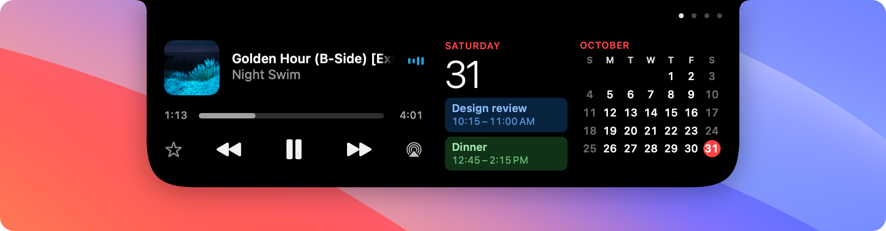
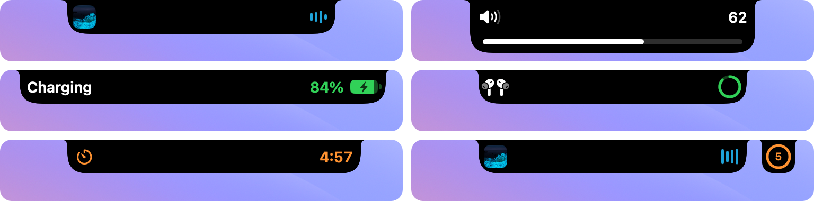

<p align="center">
  
</p>

<h1 align="center">Nook</h1>

<p align="center">
  Your Mac's notch, as a live island.<br>
  A light menu-bar app that grows out of the notch when something happens.
</p>

<p align="center">
  <a href="https://github.com/sanvithreddyy/nook/releases/latest"><b>Download for macOS</b></a>
  · macOS 15 or later · Apple silicon and Intel
</p>

<p align="center">
  
</p>

<p align="center">
  
</p>

## What it does

**In the notch.** The island grows out to the sides of the notch to show what's happening,
then settles back:

- What's playing, with its artwork and a live waveform.
- Volume and brightness, in place of the macOS pop-up, in four styles.
- Charging, unplugging, low battery and Low Power Mode.
- AirPods and other Bluetooth devices connecting, with their battery.
- Sound moving to another output.
- Locking and unlocking.
- A meeting about to start, and a running timer. A second activity gets its own small
  drop beside the island.

**Open.** Rest the pointer on the island, click it, or swipe down on it with two fingers.

- Pages of modules you arrange in Settings: Music, Calendar, Batteries, Weather,
  Reminders, World Clock, Shortcuts and Timer. Swipe sideways between pages, and pick
  the one it opens to.
- The shelf: drag files to the notch to keep them close, then drag them out again or
  AirDrop them.

**Fits your setup.**

- On a Mac without a notch, the island is drawn as a notch or a pill, or stays hidden
  until something happens.
- Show it on the built-in display, the main display, every display, or one you choose.
- Hide it while an app is full screen, and from screenshots and screen recordings.
- Keyboard shortcuts you choose to open it, play, pause and skip, start a timer or open
  the shelf.

## Install

### With Homebrew

```
brew install --cask sanvithreddyy/nook/nook
```

Use the full name: a plain `brew install nook` installs a different app. Homebrew
installs the same release, opens it without the Open Anyway step, and `brew upgrade`
keeps it current.

### From the download

1. Download `Nook-<version>.dmg` from
   [Releases](https://github.com/sanvithreddyy/nook/releases/latest) and drag Nook to
   Applications.
2. Open Nook. The first launch is blocked because the app isn't notarized: choose
   **Open Anyway** in System Settings → Privacy & Security. Each new version asks once.

Nook lives in the menu bar. Its icon there opens Settings; if you hide the icon, open
Nook again from Applications.

## Permissions

| Permission | Used for |
| --- | --- |
| Accessibility | Volume and brightness in place of the macOS pop-up |
| Calendars | Your next meeting, and the Calendar module |
| Reminders | The Reminders module, where you tick off and add reminders |
| Location | The weather where you are, unless you choose a city |
| Bluetooth | Notices when headphones and other devices connect |

## Privacy

Everything Nook shows is read on your Mac, except the weather. For the forecast, Nook
sends your location, rounded to about 100 metres, to
[Open-Meteo](https://open-meteo.com); Apple's geocoder turns it into a city name, and
Apple Maps answers when you search for a city. Files on the shelf stay where they are; text, links and images
dropped there are saved in `~/Library/Application Support/Nook/Shelf` until you remove
them.

## Build from source

Requires Xcode 27 and [XcodeGen](https://github.com/yonaskolb/XcodeGen)
(`brew install xcodegen`).

```sh
scripts/build.sh            # generates the project and builds Debug into build/
open build/Build/Products/Debug/Nook.app
```

The project signs ad hoc by default. macOS ties Accessibility access to the signature,
so an ad hoc build asks again after every rebuild. To keep it, copy
`Config/Signing.local.example.xcconfig` to `Config/Signing.local.xcconfig` and fill in
your signing identity.

### Test

```sh
scripts/test.sh        # unit tests
scripts/snapshots.sh   # renders every island state over a system wallpaper to build/snapshots
```

The tests compile the app's code into the test bundle, so the notch app never launches.
The snapshots use the Debug build.

### Release

```sh
NOOK_SIGN_IDENTITY="Apple Development" scripts/release.sh --no-notarize
```

The signed, universal DMG lands at `build/release/Nook-<version>.dmg`. To ship a
notarized DMG instead, which needs a paid Apple Developer membership, create a
**Developer ID Application** certificate in Xcode → Settings → Accounts → Manage
Certificates, store notarization credentials once, then run `scripts/release.sh`
without arguments.

```sh
xcrun notarytool store-credentials nook --apple-id <email> --team-id <team> --password <app-specific-password>
```

Set `DEVELOPMENT_TEAM` in `Config/Signing.local.xcconfig` (or `NOOK_TEAM_ID`).
`NOOK_SIGN_IDENTITY` defaults to `Developer ID Application` and `NOOK_NOTARY_PROFILE`
to `nook`. Each release also updates `version` and `sha256` in the
[Homebrew cask](https://github.com/sanvithreddyy/homebrew-nook).

### Layout

```
Nook/
  App/              Launch, menu-bar icon, app menus
  Notch/            The island: window, shape, state, open pages, gestures
  Activities/       One folder for each thing it shows: now playing, volume, battery, shelf…
  Motion/           Every spring the island uses
  Settings/         The Settings window and its panes
  Support/          Preferences, haptics, keyboard shortcuts, places
  Assets.xcassets/  App icon and menu-bar glyph
NookTests/          Unit tests
Vendor/             mediaremote-adapter, for what's playing
Config/             Signing configuration
scripts/            Build, test, snapshot, capture and release scripts
docs/images/        README images
```

## Acknowledgements

What's playing comes through
[mediaremote-adapter](https://github.com/ungive/mediaremote-adapter) by Jonas van den
Berg, under the [BSD 3-Clause License](Vendor/MediaRemoteAdapter/LICENSE).

## License

[MIT](LICENSE)
